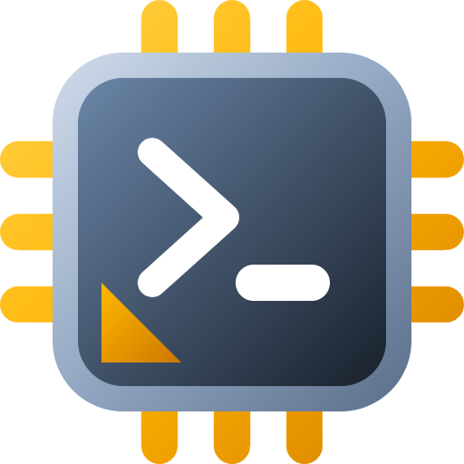

# corehost

**corehost** is a reimplementation of Windows conhost.

  

## Table of Contents

<ul>
  <li><a href="#background">Background</a></li>
  <li><a href="#positioning">Positioning</a></li>
  <li><a href="#development">Development</a></li>
  <li><a href="#corehost-as-conhost">corehost as conhost</a></li>
  <li><a href="#how-to-use-it">How to use it</a></li>
  <li><a href="#compatibility">Compatibility</a></li>
  <li><a href="#how-to-build">How to build</a>
    <ul>
      <li><a href="#build-targets">Build targets</a></li>
      <li><a href="#cmake-options">CMake options</a></li>
    </ul>
  </li>
  <li><a href="#architecture-and-startup-flow">Architecture and startup flow</a>
    <ul>
      <li><a href="#mode-1-corehost-as-conhostexe">Mode 1: corehost as conhost.exe</a></li>
      <li><a href="#mode-2-corehost-as-the-default-console-com-server">Mode 2: corehost as the default-console COM server</a></li>
      <li><a href="#mode-3-conpty">Mode 3: ConPTY</a></li>
      <li><a href="#conpty-runtime">ConPTY runtime</a></li>
    </ul>
  </li>
  <li><a href="#design">Design</a></li>
  <li><a href="#the-future-of-the-windows-console-and-corehost">The Future of the Windows Console and corehost</a></li>
</ul>

## Background

The original Windows console, after 36 years and more than four generations of development, has poor code quality and is fragile.

Moreover, almost all console state and a mutex protecting it are globally shared and mutable, which makes it impossible to use as an in-process library.

Actually, the Windows Console team also agrees that it is far from ideal; see https://github.com/microsoft/terminal/blob/main/doc/specs/%2313000%20-%20In-process%20ConPTY.md and other comments you can find in the repo's issue tracker.

## Positioning

Its goal is to act as **a A full-featured terminal built with technology that is as modern as possible, and a bridge between the Terminal GUI and the Windows console system**. To that end, corehost implements four core features:

- When running as conhost.exe, dispatch the console application to the default terminal.
- As the default console, acts as a bridge between the console application and the terminal.
- As the implementer of the Windows system, one codebase drives both windowless console applications and pseudo console at the same time.
- Window mode, as a full-featured Windows terminal.

corehost aims to provide **high performance** for driving:

- Windows Terminal
- Contour
- Alacritty
- ConEmu
- and other Windows terminals

Actually, corehost is the ideal OpenConsole/conhost.

## Development

corehost is based on in-depth research of microsoft/terminal, but its codebase is not derived from microsoft/terminal; it was written entirely from scratch.

corehost **does not use any mutable global variables**, and **no singletons, including magic statics**, are used. All state is **passed through function parameters** and is modularized as much as possible.

This allows corehost to be used as a library, and no matter how many times it is loaded in the same process or what operations it performs, each instance will always remain isolated from the others because they share nothing. corehost also provides high-quality code that helps anyone who wants to improve the Windows console or develop their own Windows terminal understand how the Windows console works.

Although corehost is written using platform-neutral code and relies only on features provided by Windows 8, corehost still deliberately restricts the minimum requirements via CMake to x86_64 v2, ARM v8.2A, and Windows 10.

## corehost as conhost

corehost solves the problem that the original version of conhost does not support opening the default terminal (e.g., Windows Terminal) when calling `AllocConsole`.

(corehostw todo: remove the following after full implementation)

When corehost runs with elevated integrity (High IL) due to sudo or runas, UIPI prevents COM activation and handle transfer to Medium IL terminals. Since no GUI is available (the only GUI available to the original conhost is itself), corehost will refuse to execute the program and send a message in the notification center about what happened.

Some third-party programs incorrectly launch other programs indirectly through an administrator-mode cmd. Since cmd lacks an equivalent to PowerShell's `-WindowStyle` parameter, this typically manifests as a conhost window that flashes briefly at boot. After replacing conhost with corehost, these programs may work properly, or they may fail.

Note that since msix applications cannot run in safe mode, please backup the system's conhost.exe as an alternative terminal.

## How to use it

corehost supports four usage modes.

First, you can directly replace conhost.exe with corehost.exe, and corehost will take over all functionality of conhost, except that it does not support window mode.

Then, you can use the scripts in the scripts directory to register corehost as the default console. In this mode, when you launch cmd using Run, corehost will take over the functionality of OpenConsole.

corehost can also be used together with conpty.dll to provide ConPty support for third-party terminals. If you are using conpty.dll released by Microsoft, rename corehost.exe to openconsole.exe; if you are using corehost's libconpty, you can directly use corehost.exe.

Finally, corehostw.exe provides a full-featured terminal GUI based on DWrite3, DComposition3, and DirectX12. Built with the most advanced graphics technology on Windows.

Additionally, corehost can be used as a C++ library by third-party terminals, as described below. In this working mode, inter-process communication is completely avoided.

## Compatibility

During development, corehost was tested using cmd, powershell, pwsh, vim and edit. If you encounter any compatibility issues, including when using other programs, please submit an issue report.

## How to build

1. MSVC 14.51+ or Clang 20+.
2. CMake 4.3 or later
3. `git clone --recurse-submodules --shallow-submodules https://github.com/YexuanXiao/corehost`
4. `cmake -B build`
5. `cmake --build build --config Release`

Refer to CI for cross compilation and building with Clang.

### Build targets

- `corehost`: the main executable which provides the functionality of conhost/OpenConsole.
- `corehostw`: A graphical interface has been implemented on top of corehost. corehost requires a minimum of Windows 10, while corehostw requires a minimum of Windows 11.
- `libcorepty`: The entry point of ConPTY, which assembles the console runtime and the VT input/output from the terminal GUI. Third-party terminals can link libcorepty into their programs without needing to use an external conhost process.
- `conpty`: the shared library form of libconpty for third-party terminals that export the symbols declared by winconpty.h.
- `conpty_static`: the static library form of libconpty.
- `conhost_proxy`: the COM proxy/stub DLL used by default-terminal handoff and COM embedding.

### CMake options

| Option | Default | Description |
| --- | --- | --- |
| `COREHOST_DISABLE_LOG` | `ON` | Disables corehost logging. Set it to `OFF` when diagnosing behavior with log files. When corehost.exe is in the system32 directory, logs are written to `GetTempPath`/logs; otherwise, they are written to the directory part of `GetModuleFileName`/logs. |
| `COREHOST_LOG_LEVEL` | `1` | Compile-time log frequency level. `1` records low-frequency events, `2` also records medium-frequency events, and `3` also records high-frequency events. This only matters when `COREHOST_DISABLE_LOG=OFF`. |
| `COREHOST_PERF_DIAG` | `OFF` | Enables aggregated performance diagnostics inside corehost. This is for profiling and should stay disabled for normal performance comparisons. |
| `COREHOST_ANSI_OPT` | `OFF` | Enables optional table-driven ANSI code page fast paths. For users who have enabled UTF-8, this is unnecessary and will increase the binary size. |
| `COREHOST_DEFAULT_UTF8` | `ON` | Make UTF-8 the default console code page and make UTF-8 as corehost's active code page. |
| `COREHOST_RUN_AS_UTF8` | `ON` | Make UTF-8 as corehost's active code page. |
| `COREHOST_VERSION` | `0.0.0.0` | Sets the version baked into `corehost.exe` and `corehost/version.h`. Accepts dot-separated numbers such as `1.2.3.4`; missing segments default to `0` and extra segments are ignored. |
| `COREHOST_ENABLE_ASAN` | `ON` | Enable AddressSanitizer in MSVC Debug builds. |
| `USE_INBOX_CONHOST` | `OFF` | Make libconpty only use the system's conhost.exe. |

## Architecture and startup flow

corehost is built around one common runtime. The different startup modes mainly decide where the ConDrv handle comes from, whether a terminal GUI must be created, and which handoff protocol is used before the console runtime session starts. All code of the console runtime are headers and can be used independently; code exclusive to ConPTY accounts for only 2.8% of the console runtime.

### Mode 1: corehost as conhost

Windows starts conhost.exe for classic console allocation paths, such as launching a console process with `CreateProcess` and `CREATE_NEW_CONSOLE`, using Run to start a console program, or calling `AllocConsole` from a GUI process. In this path ConDrv.sys launches conhost with a command-line handle value such as `0x4`. This value is the process-local numeric value of an already-open ConDrv `\Server` handle. The `\Server` object is the user-mode conhost's control endpoint for one console session: ConDrv produces console requests on it, and corehost consumes those requests and returns completion results. During `CONNECT`, corehost opens the session's `\Input` and `\Output` objects relative to that `\Server` handle. Those two client handles are handed back to ConDrv and become the console input and console output handles observed by the attached program. When the program later calls console APIs or reads/writes those handles, ConDrv turns that client-side activity into requests that corehost receives through `\Server`.

The first important ConDrv message is the `CONNECT` request. Its payload is a `CONSOLE_SERVER_MSG`. This structure contains startup information that originally came from the client process and the Windows console subsystem, including the requested title, show-window flag, initial buffer/window size, process group id, whether the client is a console progeam, and whether a visible window is expected.

If `CONSOLE_SERVER_MSG` says that the client needs a visible console UI, corehost looks up the configured default terminal COM class under `HKCU\Console\%%Startup`. The relevant registry values are `DelegationConsole` for the first handoff step and `DelegationTerminal` for the second terminal handoff step. In this direct conhost path, corehost creates the configured terminal's `IConsoleHandoff` object and passes the ConDrv server handle, the ConDrv input-available event, a portable description of the pending `CONNECT` request, a signal pipe, and a corehost process handle. A successful `IConsoleHandoff` call transfers the visible session to that default-terminal implementation. In the current path, corehost does not start its own console runtime loop after this first-hop handoff; it waits for the terminal process or signal pipe to close and then returns.

If the `CONNECT` request does not require a visible GUI, corehost accepts the ConDrv connection itself and enters the most simplified mode, which only provides a headless virtual console environment sufficient for what a console program to run. There is no terminal window and user input, but console APIs still need coherent behavior.

### Mode 2: corehost as the default-console COM server

When corehost is registered as an `IConsoleHandoff` implementation, the conhost.exe start it with `-Embedding`. In this mode corehost is not launched directly with the initial ConDrv handle. Instead, COM activates corehost and invokes the default-terminal handoff entry point.

The incoming `IConsoleHandoff` call provides the ConDrv server handle, the input-available event, a portable attach message that identifies the pending `CONNECT` request, a signal pipe, and process handles used to coordinate lifetimes. The portable attach message intentionally contains only the stable descriptor fields needed to find the original request. It does not contain the full `CONSOLE_SERVER_MSG`, so corehost reads the original `CONNECT` payload back from ConDrv when it needs the startup title, `ShowWindow`, and related startup data.

During the handoff call, corehost duplicates the ConDrv server handle and input event supplied by the inbox conhost, creates a ConDrv `\Reference` handle, opens the client process, reads the original `CONSOLE_SERVER_MSG`, and then looks up the configured terminal-side CLSID. It creates an `ITerminalHandoff3` object, currently implemented by Windows Terminal, passes terminal startup information and process handles, and receives a pair of VT pipes from the terminal. Once that succeeds, corehost accepts the original ConDrv `CONNECT` request and starts its console runtime using the resulting handles. From that point on, the terminal owns the GUI side of the session, while this corehost process remains the console server that consumes the ConDrv messages and completes the corresponding console requests.

After the handoff, corehost enters ConPTY mode.

### Mode 3: ConPTY

`ConptyCreatePseudoConsole` or `CreatePseudoConsole` starts corehost with `--headless`. They creates the ConDrv server handle, a signal handle, and the VT input/output pipes, then launches corehost with arguments such as `--server`, `--signal`, and others.

corehost parses those arguments, adopts the inherited handles, initializes the session configuration, and enters ConPTY mode immediately.  The task of corehost is to convert messages from the console program into VT output, and to receive messages from the terminal GUI via VT input, update the console state, and then send them back to the console program. This is the path used by applications that explicitly use the ConPTY API and provide their own terminal frontend and also the Mode 2 will eventually enter.

The terminal and corehost keep separate state for the same session. The terminal owns the visible UI and terminal-facing state, such as windows, tabs, rendering, selection, scrollback, and its VT screen model. corehost owns the Windows console-server state, including process membership, console modes, input records, code pages, API-visible cursor/attribute state, the API-readable screen buffer, pending ConDrv requests, and control-event routing. The terminal does not implement Windows Console APIs, and corehost does not own the visible UI.

### Mode 4: Real terminal window

(corehostw todo: fill in the content after full implementation)

### Console runtime

The Console runtime is the shared implementation used by all three startup modes. It is intentionally split into a few functional areas:

- ConDrv I/O reads requests from the ConDrv, completes previous requests, accepts `CONNECT`, and keeps the client `\Input` and `\Output` handles alive for as long as the session exists.
- The message router decodes console API messages and dispatches them to focused handlers. These handlers implement the observable Windows console API behavior that programs expect.
- The console state stores process membership, modes, code pages, cursor state, attributes, title, tab stops, scrolling region, and other state that must be visible through console APIs.
- The screen buffer models the visible console buffer needed by APIs such as cursor positioning, text writes, erase operations, scrolling, and screen reads. It is not a renderer; it is the state model that lets corehost answer console API requests correctly.
- The input buffer stores keyboard and control input in console-event form. VT keyboard sequences from the terminal are decoded into console input records when the client reads from the console input handle.
- The VT parser converts terminal-side VT input into structured messages. It recognizes text, cursor movement, erase operations, SGR, OSC title and hyperlink sequences, terminal replies, and keyboard sequences. Unknown or unsupported sequences are preserved in a form that allows the caller to either pass them through or expose printable text when appropriate.
- The VT output path serializes console output and console-state changes back to VT for the terminal frontend. It buffers output so that large console writes do not become one small `WriteFile` call per character or per escape sequence.
- The signal path handles terminal-side control notifications, such as close, resize, and control events, and maps them into the Windows console behavior expected by attached processes.

Data mostly flows in two directions. Output from a console application arrives as ConDrv API messages, is applied to the local console and screen state, and is serialized as VT to the terminal. Input from the terminal arrives as VT bytes, is parsed into keyboard, text, control, or terminal-response messages, and is then exposed to the console application through the input APIs. This is the core bridge that lets Windows console programs run behind a modern terminal frontend while still observing Windows console semantics.

## The Future of the Windows Console and corehost

corehost currently has three issues:

1. corehost's compatibility is not yet good enough; it requires a large amount of user feedback to improve compatibility. If you care about the future of the Windows Console, please follow this project and actively try it out. All your compatibility feedback will be recorded and documented.
2. corehost's code is not yet good enough. First, I must admit that most of the code in corehost was written by AI, but I guarantee that I participated in the design of the vast majority of functions and classes. Although I have reviewed it again and again to ensure that the AI wrote meaningful code, my energy is limited and I cannot guarantee that it is optimal.

## Acknowledgement

The implementation of corehost is built on the following three codebases:

I thank the Windows Console team for open-sourcing [conhost](https://github.com/microsoft/terminal) and for their patient, professional responses to several questions. Windows Terminal's GUI code also helped corehost. It was a pleasure to communicate with you. I also thank [Ghostty](https://github.com/ghostty-org/ghostty), from which corehost learned how to correctly represent the console’s internal structures. Finally, I thank Contour for providing a high-quality [C++ Unicode library](https://github.com/contour-terminal/libunicode).
