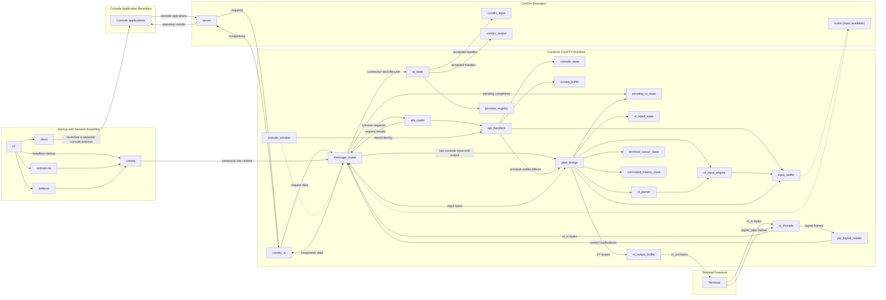
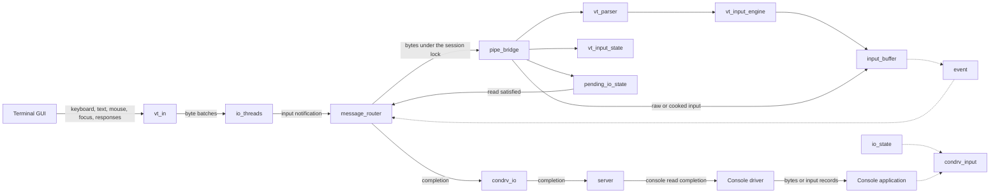

# corehost Architecture

## Purpose and Scope

corehost is a console server that keeps Windows console semantics on one side
and a terminal frontend on the other side. Console applications reach corehost
through the console driver boundary. The terminal reaches corehost through VT
input and output streams and a control-signal stream. corehost owns the console
state, while the terminal owns the visible UI, rendering, and terminal-side
screen model.

This document describes the common runtime used by the headless, COM handoff,
and default-terminal handoff paths. It focuses on data flow and module
responsibilities rather than on the console API reference.

## System Context

The system has two external boundaries.

### Console Driver Boundary

Console applications issue console operations. The driver turns those
operations into requests delivered on `server`. corehost consumes those
requests, applies the requested console behavior, and returns completion data
on `server`.

The accepted `condrv_input` and `condrv_output` handles represent the
client-facing console objects for the session. corehost keeps them open for the
lifetime of the console session. They are not separate byte streams for the
main request loop; the request and completion metadata travels on `server`.

### Terminal Boundary

UTF-8 and VT input bytes arrive from the terminal on `vt_in`. UTF-8 and VT
output bytes leave corehost on `vt_out`. Terminal control notifications, such
as visibility, clearing, parent-window, and resize changes, arrive on
`signal_pipe`.

The `event` handle is an input-availability notification. It is not a
keyboard, mouse, or text stream.

The pseudo window publishes `hwnd` so console applications have a console
window identity. Window close, show, and hide activity is delivered to the
session loop as notification events; the window thread does not modify console
state directly.

## Handle and Data-Boundary Table

| Handle | Direction | Lifecycle and user | Functional role |
| --- | --- | --- | --- |
| `server` | Both directions | Supplied by the startup path; used by the session loop | Console request source and completion sink. Requests carry client operations; completions carry results, status, and output payloads. |
| `event` | Driver notification into corehost | Supplied by the driver in handoff paths; a local notification exists for headless operation; waited on by the session loop | Signals that console input may be available or that a pending wait should be re-evaluated. |
| `condrv_input` | Client input object | Accepted and held by the session for its lifetime | Represents the console input endpoint observed by the connected application. |
| `condrv_output` | Client output object | Accepted and held by the session for its lifetime | Represents the console output endpoint observed by the connected application. |
| `vt_in` | Terminal to corehost | Supplied by the terminal or inherited as the standard input stream | UTF-8/VT stream containing keyboard input, text, mouse reports, terminal responses, and focus notifications. |
| `vt_out` | corehost to terminal | Supplied by the terminal or inherited as the standard output stream | UTF-8/VT stream containing screen output, cursor changes, attributes, titles, and terminal-control sequences. |
| `signal_pipe` | Terminal to corehost | Supplied by the terminal handoff path; may be absent | Framed control notifications for visibility, clearing, parent-window changes, and resize. |
| `hwnd` | Window identity and notifications | Created by the pseudo-window module | Hidden window identity returned to callers that need a console window handle; the source of close, show, and hide notifications. |

The pseudo window also exposes close, show, and hide notification events. These
events wake the session loop; they do not carry console data.

## Architecture Diagram

Solid arrows represent data or request/response flow. Dotted arrows represent
wakeup or notification edges.

## Data Flow by Handle

This section expands the main diagram along the path taken by each data source
and sink. It distinguishes byte streams, object-lifetime handles, request
metadata, and wakeup notifications.

### Terminal GUI Input: `vt_in` to the Console Application

The terminal GUI produces keyboard, composed text, mouse, focus, and terminal
response data. The terminal translates that activity into UTF-8/VT bytes and
writes the bytes to `vt_in`.

1. The terminal GUI receives a physical key or pointer action and converts it
   to terminal input bytes. The bytes are written to the terminal-to-corehost
   pipe represented by `vt_in`.
2. `io_threads` reads `vt_in`. The asynchronous terminal pipe is read with a
   completion event; a synchronous pipe uses a blocking read path. The reader
   does not mutate console state outside the session lock.
3. `message_router` receives the byte batch and passes it through
   `pipe_bridge` under the session lock.
4. `pipe_bridge` feeds the UTF-8 and VT streams through `vt_input_state`, which
   preserves incomplete sequences across read boundaries.
5. `vt_parser` classifies complete messages: text, key events, mouse reports,
   focus responses, terminal query responses, and control characters.
6. `vt_input_engine` turns key and control messages into console input records
   when the waiting client expects records.
7. `pipe_bridge` chooses the destination required by the pending read:
   - raw byte read: the original terminal bytes are retained and returned;
   - cooked line read: the line editor consumes the text, applies local
     editing, and echoes the visible result through the output path;
   - console input record read: records are appended to the input queue.
8. `input_buffer` stores records and updates the input-availability
   notification. The `event` handle wakes the main loop. If a read is already
   pending, `pending_io_state` identifies its kind and the read is completed.
9. `condrv_io` submits the completion on `server`. The connected application
   receives the returned bytes or records through its console input object.
   `io_state` keeps the accepted `condrv_input` handle alive so the object does
   not disappear while the application still owns it.

The terminal GUI never writes directly into the console application. It only
writes terminal input; corehost converts or forwards that input according to
the application's console mode, active read type, and terminal input mode.

### Console Output: Application to the Terminal GUI Through `vt_out`

The console application writes through its console output object. The
corresponding corehost endpoint is `condrv_output`; corehost keeps that accepted
object alive, while the operation itself arrives as a request on `server`.

```mermaid
flowchart LR
    APP["Console application"] -->|console output operation| DRV["Console driver"]
    DRV -->|request| SERVER["server"]
    SERVER -->|request| TRANSPORT["condrv_io"]
    TRANSPORT -->|request| ROUTER["message_router"]
    ROUTER -->|console behavior| API["api_router / api_handlers"]
    API -->|state and screen updates| STATE["console_state / screen_buffer"]
    API -->|terminal-visible effects| BRIDGE["pipe_bridge"]
    BRIDGE -->|formatted VT output| OUTBUF["vt_output_buffer"]
    OUTBUF -->|vt_out bytes| VTOUT["vt_out"]
    VTOUT -->|UTF-8/VT rendering input| GUI["Terminal GUI"]
    ROUTER -->|completion| TRANSPORT
    TRANSPORT -->|completion| SERVER
    SERVER -->|operation result| DRV
    DRV -->|operation result| APP
    IOSTATE["io_state"] -.-> COUT["condrv_output"]
    APP -.-> COUT
```

1. The application performs a console output, cursor, attribute, erase, scroll,
   title, or screen-buffer operation through its output console object.
2. The console driver turns the operation into a request on `server`.
3. `condrv_io` provides the request payload to `message_router`.
4. `message_router` dispatches the operation to `api_router`, which selects the
   operation family and the active screen buffer.
5. `api_handlers` applies the operation to `console_state` and, when relevant,
   to the active `screen_buffer`.
6. `pipe_bridge` converts the resulting terminal-visible state into UTF-8/VT
   bytes. Application-provided terminal bytes are forwarded directly when the
   operation is a raw or VT passthrough; console-model changes are serialized
   as cursor movement, attributes, text, erase, scroll, or alternate-screen
   sequences.
7. `vt_output_buffer` batches the bytes. The batch is flushed to `vt_out` at a
   completion boundary, a terminal-read synchronization point, or an output
   size threshold.
8. The terminal GUI consumes `vt_out` and updates its visible screen.
9. The completion for the console operation is returned on `server`; the
   application observes the result through its output console object.

### Other Handles and Their Data Flow

| Handle | Producer or source | Modules involved | Consumer or sink | What moves |
| --- | --- | --- | --- | --- |
| `server` | Console driver, on behalf of console applications | `condrv_io`, `message_router`, `io_state`, `api_router`, `api_handlers`, `pipe_bridge` | Console driver, returning to the application | Console requests, completion status, result payloads, and connection data. Requests arrive on this handle; completions leave on it. |
| `condrv_input` | Accepted by `io_state` during connection setup | `io_state`; completion path through `message_router`, `pipe_bridge`, and `condrv_io` | The connected application's console input object | No byte stream is read directly from this accepted handle. It keeps the client input object alive; input data is delivered through completions on `server`. |
| `condrv_output` | Accepted by `io_state` during connection setup | `io_state`; request path through `condrv_io`, `message_router`, `api_router`, `api_handlers`, and `pipe_bridge` | The connected application's console output object | No terminal bytes are written directly to this accepted handle. It keeps the client output object alive; output operations arrive on `server` and results return on `server`. |
| `event` | Console input queue state or driver notification | `input_buffer`, `message_router` | Main session wait loop | Input-availability and wakeup state only. It carries no keyboard or mouse bytes. |
| `signal_pipe` | Terminal GUI control notifications | `io_threads`, `pty_signal_reader`, `message_router`, `pseudo_window`, `pipe_bridge` | Console state, pseudo window, and terminal | Framed notifications for visibility, clearing, parent-window changes, and resize. Resize may also produce a console window-size event for the application. |
| `hwnd` | `pseudo_window` | `api_handlers`, `pseudo_window`, `message_router` | Console applications that query window identity | A hidden window identity. Close, show, and hide activity is delivered as notification events, not as console data bytes. |
| `vt_in` | Terminal GUI | `io_threads`, `message_router`, `pipe_bridge`, `vt_parser`, `vt_input_engine`, `vt_input_state` | Console application through pending reads | UTF-8/VT terminal input, including keyboard, text, mouse, focus, and terminal responses. |
| `vt_out` | `vt_output_buffer` | `pipe_bridge`, `vt_output_buffer` | Terminal GUI | UTF-8/VT terminal output, including text, attributes, cursor changes, erase/scroll effects, and alternate-screen changes. |

### Direction Summary

| Path | Direction | Primary handles | Observable result |
| --- | --- | --- | --- |
| Terminal keyboard and pointer input | Terminal to console application | `vt_in`; completion on `server` | The application's input read returns bytes or input records. |
| Console output and screen changes | Console application to terminal | `server` request; `vt_out` output | The terminal GUI displays the updated screen. |
| Connection and object lifetime | Console driver to corehost and back | `server`, `condrv_input`, `condrv_output` | The application keeps usable console input and output objects. |
| Input readiness | Console input queue/driver to session loop | `event` | The main loop wakes and checks pending reads. |
| Window and resize control | Terminal GUI to corehost | `signal_pipe` | Screen, viewport, window identity, or visibility changes. |
| Console window identity | corehost to application | `hwnd` | The application receives a valid console window handle. |

## Module Responsibilities

### Startup and Session Assembly

| Module | Functional responsibility |
| --- | --- |
| `cli` | Interprets the launch mode and routes the process to COM handoff, default-terminal handoff, headless session startup, or client execution. |
| `comserver` | Receives a console handoff from an inbox console host, restores the connection context, obtains the terminal streams, and enters the common runtime. |
| `defterm` | Receives the console driver handle, attempts terminal handoff when a visible console is expected, and falls back to a headless session or disconnects when no terminal can serve the session. |
| `client` | Launches a requested console program in a separate new console; that process follows the normal handoff path and does not host the common runtime itself. |
| `conpty` | Builds the shared state, main and alternate screen buffers, input and output buffers, bridge, API router, pseudo window, message router, and I/O threads; enters the session loop. |

### Driver Transport and Session Control

| Module | Functional responsibility |
| --- | --- |
| `condrv_io` | Reads driver requests, reads additional request payloads, accepts first connections, creates client objects, and submits completions. |
| `io_state` | Tracks the server, accepted client handles, object identities, the connected process set, and process groups. |
| `message_router` | Owns the session lock, reads and classifies requests, dispatches console behavior, coordinates pending requests, runs the main wait loop, and drives shutdown. |

### Console Behavior

| Module | Functional responsibility |
| --- | --- |
| `api_router` | Classifies console requests into basic, screen/window, and extended groups; determines whether a request targets an input or output object; selects the active screen buffer. |
| `api_handlers` | Implements console operations by reading or updating shared state, screen content, input records, history, process metadata, or terminal-visible effects. |
| `pending_io_state` | Records which kind of client read is waiting: raw byte input, cooked console input, or console input records. It defines when incoming terminal data satisfies the wait. |
| `process_registry` | Maintains connected processes and process groups for process-list queries and control-event delivery. |

### Terminal Input

| Module | Functional responsibility |
| --- | --- |
| `io_threads` | Reads `vt_in` without blocking the main request loop and reads framed notifications from `signal_pipe`; both paths enter the session loop through the session lock. |
| `vt_input_state` | Preserves UTF-8 decoder state, parser state, queued input, cooked-line content, and line-editing state across partial reads. |
| `vt_parser` | Converts the terminal byte stream into structured text, key, mouse, response, and control messages. |
| `vt_input_engine` | Converts key and control messages into console input records. |
| `input_buffer` | Queues console input records and maintains the input-availability notification. |
| `pipe_bridge` | Routes parsed input to the correct pending read, performs cooked-line editing and local echo when required, and completes the client read at the correct boundary. |

### Terminal Output and Shared State

| Module | Functional responsibility |
| --- | --- |
| `console_state` | Holds API-visible modes, code pages, cursor state, attributes, title, viewport metadata, alternate-screen state, history configuration, and process-related state. |
| `screen_buffer` | Holds the main and alternate character grids, attributes, viewport, scrolling, and resize behavior. |
| `pipe_bridge` | Converts screen writes, cursor changes, attributes, erase/scroll effects, titles, alternate-screen changes, and other console state changes into terminal VT output; tracks terminal cursor state; passes application-generated VT through when appropriate. |
| `vt_output_buffer` | Batches VT bytes and flushes them to `vt_out` at completion boundaries or size thresholds. |
| `terminal_cursor_state` | Tracks the terminal cursor independently from the API cursor so output synchronization does not drift. |
| `command_history_state` | Stores and browses command history for cooked line editing. |

### Window and Signal Support

| Module | Functional responsibility |
| --- | --- |
| `pseudo_window` | Creates the hidden console window, publishes `hwnd`, and translates close, show, and hide activity into notification events. |
| `pty_signal_reader` | Parses terminal control frames for visibility, clearing, parent-window changes, and resize notifications. |

## Execution Flow

### Startup Paths

- **Headless path:** the console driver server and signal stream are inherited,
  while the standard input and output streams become `vt_in` and `vt_out`.
  corehost builds the common runtime directly.
- **COM handoff path:** an inbox console host transfers the console session
  through COM activation. The receiving corehost obtains the driver endpoint,
  restores the original connection context, obtains terminal streams, and then
  builds the common runtime.
- **Default-terminal path:** the process receives a numeric console driver
  handle. It attempts to hand the visible console to the configured terminal.
  If the handoff succeeds, the terminal owns the visible side; if no terminal
  accepts the handoff, corehost either continues with a headless session or
  closes the client handles according to the startup policy.
- **Client path:** a requested console program is launched in a separate new
  console. That program follows the normal handoff path; the launching process
  does not host the common runtime.

### Startup and Connection

1. `cli` selects the startup path.
2. The selected startup path obtains the driver endpoint, terminal input and output streams, and, when available, the signal stream.
3. `conpty` constructs the shared state, both screen buffers, the input and output buffers, the bridge, the API router, the pseudo window, and the message router.
4. The pseudo-window thread starts and publishes the window identity.
5. The input and signal readers start after their state and routing dependencies exist.
6. An initial terminal handshake is sent through `vt_out` so the terminal and corehost agree on the keyboard and terminal mode.
7. The first connection request is accepted. `io_state` creates `condrv_input` and `condrv_output`, records the client process, and returns the connection data on `server`.
8. The main loop begins waiting for driver requests, input availability, window events, and signal notifications.

### Console Request and Completion

1. A console operation from a client becomes a request on `server`.
2. `message_router` enters the session lock and classifies the request.
3. Connection, disconnect, object creation, and object closure are handled by `io_state`.
4. Console operations are classified by `api_router` and executed by `api_handlers`.
5. Handlers read or update `console_state`, the active `screen_buffer`, `input_buffer`, history, or process metadata.
6. Terminal-visible changes are sent through `pipe_bridge` to `vt_output_buffer` and then to `vt_out`.
7. The result payload is returned through `server`. Requests that cannot complete immediately remain pending and are completed later when terminal input or another event satisfies them.

### Terminal Input

1. `io_threads` reads bytes from `vt_in`.
2. `message_router` passes them to `pipe_bridge` under the session lock.
3. Incomplete UTF-8 sequences and incomplete VT sequences remain in `vt_input_state` for the next read.
4. `vt_parser` classifies the bytes as text, key events, mouse reports, terminal responses, or control characters.
5. `vt_input_engine` creates console input records where the pending client expects records.
6. Cooked console input is edited in the line editor; raw byte input and console input records follow their respective paths.
7. `input_buffer` receives records and makes the input-availability notification visible.
8. The waiting client read is completed with the appropriate records or bytes. If no read is waiting, the data remains queued for the next read.

### Console Output

1. An API handler changes console state and/or screen content.
2. `pipe_bridge` serializes the terminal-visible effect as UTF-8/VT bytes.
3. Raw application-generated terminal output is passed through when that is the required behavior.
4. `vt_output_buffer` batches the bytes.
5. The buffer is flushed to `vt_out` at completion boundaries or when a size threshold is reached.
6. The client receives the console operation completion through `server`.

### Signals and Window Changes

1. `io_threads` reads a framed notification from `signal_pipe`.
2. `pty_signal_reader` decodes the notification.
3. `message_router` applies resize, clear, visibility, or parent-window changes under the session lock.
4. Window-related changes are forwarded to `pseudo_window`; terminal-visible changes are forwarded through `pipe_bridge`.
5. Notifications that arrive before the first connection are retained and applied when the console connection exists, where the protocol allows early notification.

### Shutdown

1. A client disconnect, terminal input closure, signal-stream closure, or window close requests session exit.
2. The main loop stops accepting new requests and flushes terminal output that is ready to send.
3. The input reader, signal reader, and window thread are stopped and joined.
4. Pending client reads are completed with their final result or an end-of-input result.
5. The accepted handles and remaining session objects are released.

## Concurrency and Pending-I/O Model

The session uses one lock for state shared between the request loop and the
input/signal paths. The main loop owns request dispatch. The input reader and
signal reader may wait outside the lock, but they enter the same locked session
path before changing console state, screen content, parser state, or input
records. The window thread only reports close, show, and hide notifications; it
does not mutate console state.

At most one active client read is pending at a time. A console input request
that arrives while another console input request is waiting is queued rather
than replacing the active request. When the active request completes, the
queued request becomes the next pending request.

The main loop waits on the input-availability notification, window
notifications, and an internal state-change notification. This allows terminal
input, window activity, or a request completion to wake the loop without
busy-waiting.

When a request is completed, the response is either handed back through the
current request cycle or submitted as an explicit later completion. A request
is never silently abandoned: it must be completed inline, completed through the
pending path, or completed with an error or end-of-input result.

## Failure and Edge Behavior

- If `vt_in` closes, pending reads receive an end-of-input result and the
  session can begin shutdown.
- If `signal_pipe` closes, the session treats it as a loss of terminal control
  input, not as keyboard data.
- If `vt_out` closes or the terminal disappears, buffered terminal output is
  discarded and the session begins shutdown.
- If the console connection disconnects, the process is removed from the
  session registry and the main loop exits when no further client work remains.
- Malformed or unsupported console requests receive a failure completion
  instead of corrupting shared state.
- Malformed or unknown framed terminal notifications are treated as a protocol
  failure.
- A flush or cancellation of pending input completes the waiting read
  deterministically.
- When an application owns the alternate screen, output for that screen is not
  used to mutate the main screen or main cursor. The main cursor is restored
  when the application returns to the main screen.
- The input queue is bounded. If it is full, excess records are dropped rather
  than overwriting valid records.
- Terminal output is buffered to amortize small writes. Pending output is
  flushed before completion when the protocol requires the terminal to observe
  the effect first.

## Invariants

- The driver owns the client-facing console objects; corehost must keep
  `condrv_input` and `condrv_output` alive for the session lifetime.
- `server` is the control boundary for console requests and completions; it is
  not a terminal byte stream.
- `vt_in` is the only terminal input stream; `vt_out` is the only terminal
  output stream.
- `event` is a notification, not a data source.
- API-visible state and terminal-visible state must remain coherent after every
  completed operation.
- Application-owned alternate-screen activity must not corrupt the main screen
  or its cursor.
- Window notifications are translated by the session loop before they affect
  console state.
- A client read is either completed inline or completed later through the
  pending path; it is never silently dropped.
