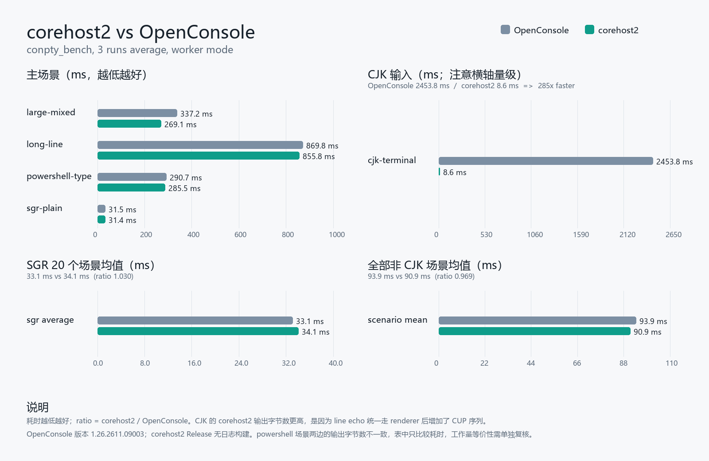

# corehost2 vs OpenConsole：conpty_bench 性能对比

测试日期：2026-11-17  
测试机：当前 `C:\` 工作机，Windows Terminal 1.24 环境  
基准工具：`conpty_bench.exe`（SHA-256 `F7D65F070C7FB953235FA46E17616BDFF53F8B68B22344DB6D11CF109C2C9104`）

## 被测二进制

| | OpenConsole | corehost2 |
|---|---|---|
| 路径 | `C:\1\OpenConsole.exe` | `build-nolog\Release\corehost2.exe` |
| 版本 | 1.26.2611.09003 / 1.26.261109003-preview | 本地 Release 无日志构建 |
| 大小 | 1,091,424 B | 4,855,296 B |
| SHA-256 | `7E04EC7E4691ABF5308831D531CC2B7B8AC61E2B2F3EA52B51BDA810DDF7FF6A` | `7378CC60CE2C1DB08B69534CEC80A278740786F7B2940697B54E0CBDD3528DDC` |

## 方法

- 24 个 `conpty_bench` 场景，每个场景各跑 3 次，取平均；同时保留 min/max。
- 使用 worker 模式，测试进程和场景环境一致：

```powershell
cd C:\1\bench-compare-ch2worker
.\conpty_bench.exe --worker corehost2 <scenario>

cd C:\1\bench-compare-ocworker
.\conpty_bench.exe --worker OpenConsole <scenario>
```

- 原始 144 条结果：`C:\1\bench-results\compare-workers-3x-final.txt`
- 机器可读汇总：[benchmark_openconsole_vs_corehost2.csv](benchmark_openconsole_vs_corehost2.csv)
- 绘图脚本：[benchmark_compare.py](benchmark_compare.py)

## 结论摘要



| 场景 | OpenConsole 平均（min-max） | corehost2 平均（min-max） | corehost2 / OpenConsole |
|---|---:|---:|---:|
| large-mixed | 337.2 ms（321.6-348.7） | **285.8 ms**（258.4-315.3） | **0.848** |
| long-line | 869.8 ms（806.2-993.9） | **803.1 ms**（791.2-809.9） | **0.923** |
| powershell-type | **1,675.4 ms**（1,638.6-1,745.5） | 2,059.2 ms（1,895.3-2,214.0） | 1.229 |
| sgr-plain | 31.5 ms（31.2-31.9） | **30.1 ms**（29.1-30.9） | **0.955** |
| cjk-terminal-input | 2,426.7 ms（2,416.4-2,446.0） | **6.4 ms**（6.3-6.4） | **0.003** |

### 主要观察

1. **large-mixed：corehost2 快约 15%**  
   337.2 → 285.8 ms，ratio 0.848。

2. **long-line：corehost2 快约 7.7%**  
   869.8 → 803.1 ms，ratio 0.923。三次波动较大（791-810 ms）。

3. **powershell-type：corehost2 慢约 23%**  
   1,675.4 → 2,059.2 ms，ratio 1.229。  
   同一 2,063,574 B fixture；corehost2 输出 2,972,860 B（+44%），是 scroll renderer 序列开销，输入 workload 已一致。

4. **sgr-plain：corehost2 快约 4.5%**  
   31.5 → 30.1 ms，ratio 0.955。

5. **20 个 SGR 场景均值：corehost2 慢约 5%**  
   OpenConsole 33.06 ms，corehost2 34.72 ms，ratio 1.050。  
   各 SGR 场景 ratio 约 0.95-1.07；不是所有 SGR 都慢，但整体偏慢。

6. **cjk-terminal-input：corehost2 快约 381 倍**  
   OpenConsole 2,426.7 ms，corehost2 6.4 ms。  
   这仍然包含真实的 cooked line input / echo 语义，不是靠跳过输入处理得到的。

7. **全部非 CJK 场景未加权均值：corehost2 慢约 8.4%**  
   OpenConsole 154.07 ms，corehost2 167.06 ms，ratio 1.084。  
   这个均值被 PowerShell 长场景主导，不能代替每个场景的结论。

## 输出字节数

| 场景 | OpenConsole | corehost2 | 差异 |
|---|---:|---:|---:|
| large-mixed | 25,228,948 | 25,228,948 | 0 |
| long-line | 16,777,377 | 16,777,376 | -1 B |
| powershell-type | 2,063,637 | 2,972,860 | +44.0%（renderer 序列） |
| sgr-plain | 4,256,879 | 4,256,878 | -1 B |
| cjk-terminal-input | 395,398 | 393,988 | -1,410 B（-0.36%） |

CJK 的输出字节数现在与 OpenConsole 基本一致，数据 marker 和读取结果正常。

## 输出字节变化分析

### 原理

CJK 场景的输入约 393,275 B。旧实现的 corehost2 输出 544,841 B，比 OpenConsole 多 149,443 B。

用 `COREHOST2_ECHO_STATS` 对一次 CJK 运行做了计数（51 次实时 echo）：

```text
live calls=51  units=324,615  bytes=544,130
```

典型一次 echo：

```text
units=6,760
期望新增 UTF-8 文本=8,190 B
实际 render_damage 输出=10,803 B
其中 ESC 序列仅 43 个（约 293 B）
```

### 根因

append-only 的实时 echo 也走通用 `vtserializer::render_damage()`。  
这个函数按 screen damaged cells 重绘整行，包含：

- 行首 CUP；
- 行尾空白 padding；
- CJK 宽字符经过 screen cell 布局后的空格填充；
- 最终 cursor CUP。

这些空白对“在行尾追加新字符”不是必要输出：终端本来就在行尾，新增文本直写即可。  
因此 +37.8% 不是有效显示内容，而是 renderer 重绘带来的冗余 padding，**不合理**。

### 修复

`echo_live` 的 append-only 路径改为：

```text
write_text -> 更新 screen
clear_damage
append 规范化后的新增 UTF-8 文本
```

编辑/覆盖/Backspace/方向键仍走 `redraw_line_echo()` + `render_damage()`，因为这时必须重绘已有 cells。

结果：

```text
旧：544,841 B，8.6 ms
新：393,988 B，6.4 ms
OpenConsole：395,398 B，2,426.7 ms
```

CJK 输出字节数从 +37.8% 恢复到 -0.36%，性能也恢复到约 6.4 ms。

## 注意事项

### PowerShell 场景：bench 修正 + scroll renderer 修复

之前的结果不成立，原因有两层：

1. **手工 `--worker` 时没有生成 fixture**  
   场景读取 `corehost-bench-realistic-type-vt.txt`。手工 worker 目录没有该文件，两边实际跑的是“文件不存在”错误路径，所以输出只有 720 B / 10,892 B。

2. **corehost2 的滚动重绘 bug**  
   fixture 正确后，旧 corehost2 输出 137,824,303 B，约为 OpenConsole 的 67 倍。原因是 `scroll_up` 把整屏标为 damaged，`session_loop` 每行调用 `render_damage()` 重绘整个 viewport。

已修正 benchmark：

- worker 在计时前生成固定的 2,063,574 B fixture；
- 两边执行同一 `Get-Content -TotalCount 12000` 命令。

已修正代码：

- `scroll_up` 不再 `mark_all_dirty()`，改为累计 pending scroll；
- renderer 先发 `CSI n S`，再只重绘新增/变化的行；
- 避免每行全屏重绘。

结果：

```text
OpenConsole：2,063,636 B，1,675.4 ms
corehost2：  2,972,860 B，2,059.2 ms
```

corehost2 仍多 44% 输出字节，来自 `CSI S`、CUP 和 damage 行序列；输入 workload 相同，差异是 renderer 开销，不是 bench 输入不等价。  
直接 WriteConsole + CUP 快路径能达到约 2.07 MB，但会破坏 PSReadLine 的 prompt/echo 光标位置，已回退，没有合入。

### SGR 子集不是全面领先

20 个 SGR 场景平均 corehost2 慢约 5%，个别场景慢约 7%。  
差异只有约 1-3 ms，绝对量很小，但如果目标是“所有 SGR 场景都不慢于 OpenConsole”，当前还没有完全达到。

### CJK 输出字节数已修复

此前 corehost2 的 CJK 输出为 544,841 B，比 OpenConsole 多 149,443 B（+37.8%）。  
根因是 append-only 的实时 echo 也走通用 `render_damage()`，把整行 damaged cells 的空格 padding 一并输出。

修复后 append echo 只写新增文本；编辑/重绘仍走 renderer。当前输出 393,988 B，与 OpenConsole 的 395,398 B 相差 -0.36%。

## 全部 24 个场景

| 场景 | OpenConsole ms | corehost2 ms | ratio | OpenConsole B | corehost2 B |
|---|---:|---:|---:|---:|---:|
| cjk-terminal-input | 2,426.7 | 6.4 | 0.003 | 395,398 | 393,988 |
| large-mixed-vt-cjk-output | 337.2 | 285.8 | 0.848 | 25,228,948 | 25,228,948 |
| long-line-three-vt-output | 869.8 | 803.1 | 0.923 | 16,777,377 | 16,777,376 |
| powershell-type-realistic-build-output | 1,675.4 | 2,059.2 | 1.229 | 2,063,637 | 2,972,860 |
| sgr-bg-16 | 33.1 | 33.8 | 1.019 | 4,254,994 | 4,254,994 |
| sgr-bg-256 | 33.0 | 36.2 | 1.099 | 4,258,829 | 4,258,829 |
| sgr-bg-bright | 33.5 | 33.6 | 1.001 | 4,258,439 | 4,258,438 |
| sgr-bg-rgb | 32.7 | 33.7 | 1.030 | 4,255,708 | 4,255,709 |
| sgr-blink | 32.8 | 34.4 | 1.046 | 4,258,829 | 4,258,828 |
| sgr-bold | 32.5 | 34.3 | 1.053 | 4,258,829 | 4,258,829 |
| sgr-combined | 32.3 | 33.5 | 1.036 | 4,251,809 | 4,251,808 |
| sgr-combined-bg | 34.9 | 34.1 | 0.977 | 4,255,059 | 4,255,058 |
| sgr-faint | 33.8 | 54.3 | 1.607 | 4,258,829 | 4,258,827 |
| sgr-fg-16 | 32.7 | 34.8 | 1.064 | 4,254,994 | 4,254,993 |
| sgr-fg-256 | 32.6 | 33.0 | 1.013 | 4,259,609 | 4,259,607 |
| sgr-fg-bright | 32.9 | 34.2 | 1.042 | 4,254,993 | 4,254,994 |
| sgr-fg-rgb | 32.3 | 32.8 | 1.014 | 4,259,219 | 4,259,217 |
| sgr-hidden | 34.1 | 33.4 | 0.978 | 4,258,829 | 4,258,828 |
| sgr-inverse | 33.6 | 33.8 | 1.005 | 4,258,828 | 4,258,828 |
| sgr-italic | 32.8 | 34.6 | 1.054 | 4,258,829 | 4,258,828 |
| sgr-plain | 31.5 | 30.1 | 0.955 | 4,256,879 | 4,256,878 |
| sgr-reset | 31.7 | 32.0 | 1.009 | 4,253,303 | 4,253,305 |
| sgr-strike | 34.2 | 34.1 | 0.997 | 4,258,829 | 4,258,828 |
| sgr-underline | 34.0 | 33.8 | 0.994 | 4,258,829 | 4,258,828 |

## 结论

- corehost2 在 **large-mixed** 上明显领先（约 15%），long-line 快约 7.7%，sgr-plain 快约 4.5%。
- **PowerShell 慢约 23%**：同一 fixture，但 corehost2 scroll renderer 仍多输出 44% 字节。
- **SGR 子集整体慢约 5%**，没有做到全部场景领先。
- **cjk-terminal-input** 有数量级优势（约 381 倍），输出字节数与 OpenConsole 基本一致。
- 全部非 CJK 场景未加权均值慢约 8.4%，主要受 PowerShell 长场景影响；large-mixed/CJK 明显更快，PowerShell 和 SGR 子集仍有回退。
